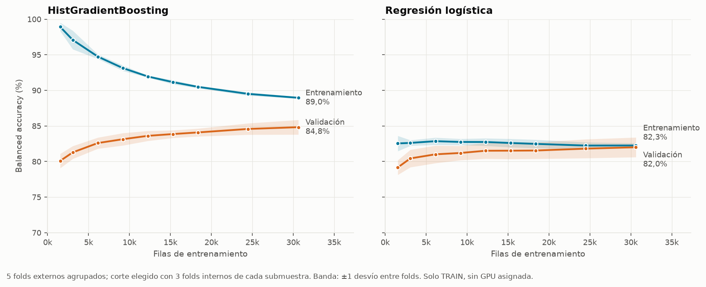

# Curva de aprendizaje (consigna 3.2)

Código: [curva_aprendizaje.py](../experiments/curva_aprendizaje/curva_aprendizaje.py). Resultados: `experiments/curva_aprendizaje/` (`puntos.csv`, `resumen.csv`, `manifest.json`, `curva_aprendizaje.png`).

## Protocolo

- Solo TRAIN; `test.csv` no se leyó. Configuraciones fijas, sin búsqueda de hiperparámetros, sin `assigned_gpu_type` ni `gpu_changed`: el HistGB elegido y la logística de referencia.
- Los mismos 5 folds externos agrupados del resto del proyecto. El fold de validación se evalúa siempre completo; solo se achica el entrenamiento.
- Submuestras del entrenamiento de cada fold, del 5% al 100% (1.533 a 30.619 filas), anidadas y por grupos de X idénticos (las copias no se separan). Las fracciones menores al 100% se repiten con 3 permutaciones.
- El corte se elige como en la selección del modelo: OOF de 3 folds internos agrupados hechos solo con la submuestra. La BA de validación no usa un corte elegido sobre el propio fold.
- Control: al 100% se reproducen exactamente las BA externas de la calibración (84,83% y 82,01%; diferencia 0).
- BA de entrenamiento: sobre la misma submuestra con el mismo corte; es diagnóstica, no un resultado.

## Resultados

| Filas de entrenamiento | HistGB train | HistGB validación | Brecha | Logística train | Logística validación | Brecha |
|---:|---:|---:|---:|---:|---:|---:|
| 1.533 (5%) | 98,9% | 80,1% | 18,8 | 82,6% | 79,2% | 3,4 |
| 3.067 (10%) | 97,1% | 81,3% | 15,8 | 82,6% | 80,4% | 2,2 |
| 6.132 (20%) | 94,8% | 82,6% | 12,2 | 82,9% | 81,0% | 1,9 |
| 12.249 (40%) | 92,0% | 83,6% | 8,3 | 82,8% | 81,5% | 1,2 |
| 18.376 (60%) | 90,5% | 84,1% | 6,4 | 82,5% | 81,6% | 0,9 |
| 24.497 (80%) | 89,5% | 84,6% | 4,9 | 82,3% | 81,8% | 0,4 |
| 30.619 (100%) | 89,0% | 84,8% | 4,1 | 82,3% | 82,0% | 0,2 |

Desvío de la validación entre folds: 0,5 a 1,0 puntos en HistGB y 1,0 a 1,4 en la logística. ROC-AUC de validación de HistGB: 0,898 → 0,936; de la logística: 0,874 → 0,904.

## Interpretación

**La logística está limitada por el modelo.** Entrenamiento y validación convergen en ~82% con una brecha de 0,2 puntos, y la validación casi no se mueve desde ~12.000 filas (+0,5 puntos del 40% al 100%). Es sesgo: más filas no la mejoran, le falta capacidad para las relaciones no lineales e interacciones vistas en el EDA.

**HistGB todavía se beneficia de más datos, pero con rendimientos decrecientes.** La validación sube de forma pareja en escala logarítmica: alrededor de **+1 punto de BA cada vez que se duplican las filas** (82,6 → 83,6 → 84,6 del 20% al 40% al 80%). La brecha baja de 18,8 a 4,1 puntos y el entrenamiento desciende hacia la validación: la parte que queda es varianza, y más datos la siguen reduciendo. Las curvas todavía no se juntaron.

**¿Más datos mejorarían significativamente?** No de forma significativa con datos del mismo tipo:
- Del 50% al 100% la mejora es +0,96 puntos, positiva en 4 de 5 folds, y del 80% al 100% es +0,25 puntos, del orden del desvío entre folds.
- Extrapolando la tendencia (es una suposición, no una medición): reentrenar con train + test (47.842 filas, 1,56 veces 30.619) daría del orden de +0,5 puntos; duplicar los datos, alrededor de +1; para ganar 2 o 3 puntos harían falta 4 a 8 veces más filas.
- El techo con estas variables queda por debajo del entrenamiento actual (89%), y parte del error parece irreducible con la información disponible: por ejemplo, los `no_show` se parecen a los completados (se detecta el 44,6%).

**Conclusión para 3.4:** el sistema está limitado más por la información de las variables que por la cantidad de filas. La forma más prometedora de mejorar es incorporar **variables nuevas**; sumar filas del mismo tipo da mejoras chicas, salvo que se concentren en las cohortes donde el modelo falla.

## Límites

- La curva mide más datos de la **misma distribución** (partición aleatoria por grupos). No dice nada sobre el cambio de distribución: entrenar solo con PRT y evaluar en el resto da ~51% con cualquier tamaño de muestra.
- La extrapolación supone que la tendencia logarítmica sigue; no se puede verificar con estos datos.
- El agrupamiento usa las 31 entradas originales, igual que el resto de la CV del proyecto.
